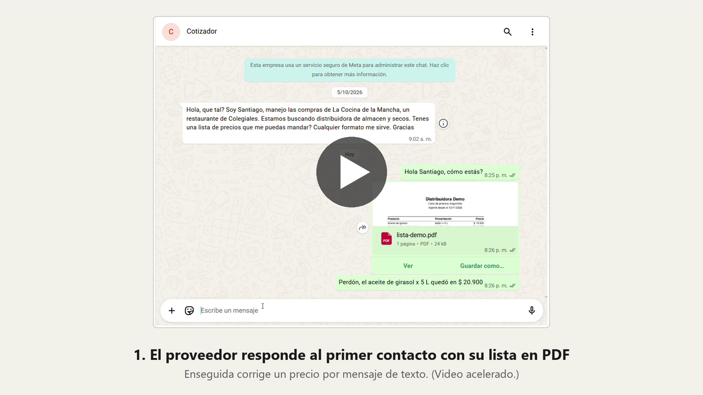
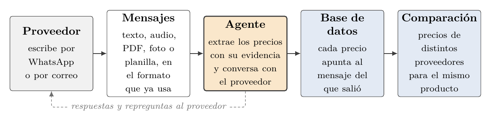
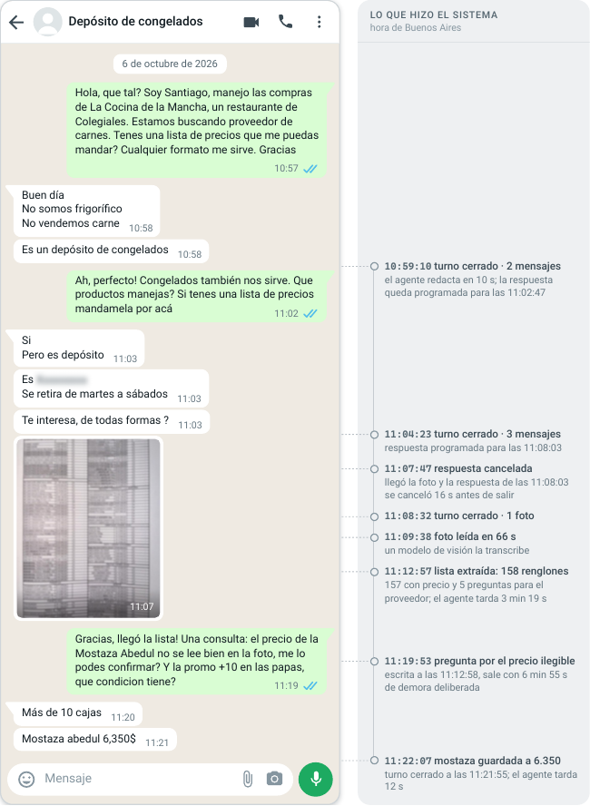
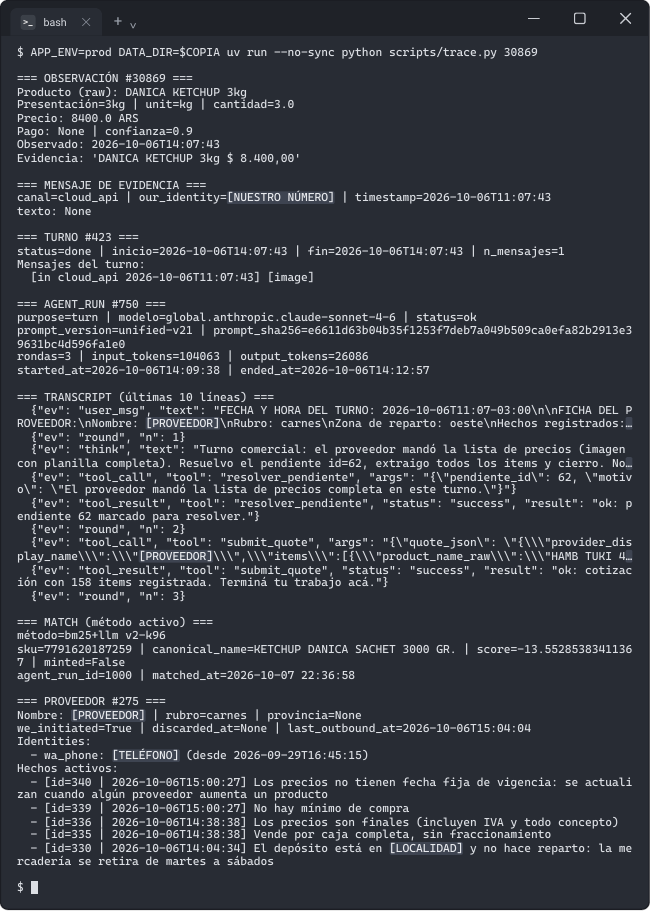

# Cotizador

**Agentes multimodales para estructurar información comercial dispersa: validación en el dominio gastronómico argentino**

Trabajo de Graduación de Ingeniería en Inteligencia Artificial, Universidad de San Andrés, noviembre de 2026.
Autor: Santiago Daniel Carrillo. Mentor: Dr. Luciano Del Corro. Comentor: Lic. Juan Wisznia.

Un restaurante recibe las listas de precios de sus proveedores por WhatsApp y por correo, cada una en su formato:
un PDF, la foto de una planilla, una nota de voz o un mensaje de texto. Alguien las pasa a mano a una planilla para
compararlas, y el trabajo se repite cada vez que cambian los precios.

El cotizador es un sistema con un agente multimodal que captura esas listas en el canal donde llegan y las convierte
en precios estructurados. Cada precio queda guardado con la cita del fragmento del que salió. El sistema operó con
proveedores gastronómicos reales de Buenos Aires hasta el 20 de octubre de 2026, y de esa operación salen todas las
cifras de esta página.

## Demostración

<p align="center"><a href="https://youtu.be/ob1ydpYHqf8"></a></p>

[Video de un minuto](https://youtu.be/ob1ydpYHqf8): un proveedor manda su lista por WhatsApp y corrige un precio, el
sistema guarda los 14 renglones con su cita y le responde por su cuenta. Se grabó sobre el sistema en producción, con
un número de prueba y una lista de precios inventada.

## Qué hay en este repositorio

- [`dataset/`](dataset/): el conjunto de datos anonimizado que acompaña al informe, con 72.702 observaciones de
  precio de 179 proveedores.
- Esta página: la demostración en video, cómo funciona el sistema, un caso real paso a paso y los resultados
  principales.

El código no está en esta primera versión. Sus pruebas y sus comentarios citan a proveedores reales, y primero hay
que anonimizarlos.

## Cómo funciona

<p align="center"></p>

1. **Contacto.** Un módulo abre la conversación con proveedores nuevos, en tandas que una persona aprueba antes de
   que salgan.
2. **Turno y lectura.** El sistema agrupa los mensajes seguidos de cada proveedor y lee cada uno según su formato.
3. **Agente.** Un agente basado en un modelo de lenguaje decide si esos mensajes traen precios o son conversación.
   Si traen precios, los guarda con la cita de su fuente. Si son conversación, responde sin que una persona apruebe
   cada mensaje.
4. **Vinculación.** Una etapa aparte vincula cada renglón con un producto de un catálogo, para poder comparar el
   mismo producto entre proveedores.

El sistema está escrito en Python y guarda todo en SQLite. Usa la interfaz oficial de WhatsApp para empresas, los
modelos Claude Opus 4.6 y Claude Sonnet 4.6 por AWS Bedrock, y el marco de agentes Deep Agents.

## Un caso real, paso a paso

El 6 de octubre de 2026 el sistema le escribió a un depósito de congelados. A la izquierda está la conversación, y
a la derecha, lo que hizo el sistema en cada momento.

<p align="center"></p>

- El proveedor mandó la lista como una foto. El sistema la leyó en 66 segundos y extrajo 158 renglones.
- Un precio no se leía bien en la foto. El agente no lo inventó y se lo preguntó al proveedor.
- La respuesta del proveedor, «Mostaza abedul 6,350$», quedó guardada como el precio de ese renglón.

Cada precio guardado se puede seguir hasta su origen. La traza de uno de los precios de esa lista muestra su cita,
el mensaje del que salió, la corrida del agente con su modelo y su versión de instrucciones, y el producto del
catálogo que se le asignó. Los datos del proveedor están tapados.

<p align="center"></p>

## Resultados principales

| | |
|---|---|
| Proveedores que recibieron el primer contacto | 320 |
| Proveedores que respondieron | 248 |
| Proveedores que mandaron una lista de precios | 170 |
| Listas de precios guardadas | 322 |
| Precios extraídos, cada uno con la cita de su fuente | 68.186 |

- **Extracción.** En una muestra de 300 renglones guardados no hubo ninguno inventado, y 279 de los 295 que no
  venían de una nota de voz tenían el precio correcto. En un banco de prueba de 18 casos reales, la versión actual
  acierta el nombre y la unidad en el 90 % de los renglones, contra el 75 % de la versión anterior.
- **Conversación.** Ninguna de las 680 respuestas conversacionales que salieron solas fue editada por una persona,
  y 169 de los 170 proveedores que mandaron una lista llegaron a ella sin que una persona escribiera en la
  conversación.
- **Comparación.** Para 36 de los 38 productos de la lista de compras del restaurante, el comprador tiene el mismo
  producto en la misma presentación cotizado por más de un proveedor.
- **Costo y tiempo.** Cada extracción costó unos USD 5,8. Hacer a mano el mismo trabajo le habría llevado a una
  persona unas 210 horas, y con el sistema, unas 13, sin contar las revisiones que quedaron abiertas.
- **Lo más débil.** La vinculación con el catálogo elige el producto correcto en 98 de 99 renglones de un corpus
  con código de barras, pero en la operación acierta en el 65 % de los renglones cuyo producto trajo la búsqueda.

## El conjunto de datos

La carpeta [`dataset/`](dataset/) trae tres archivos CSV, del 19 de agosto al 20 de octubre de 2026:

| Archivo | Filas | Qué trae |
|---|---|---|
| `proveedores.csv` | 179 | Un proveedor por fila, bajo un seudónimo (`P001`, `P002`...), con su rubro y su zona general |
| `observaciones.csv` | 72.702 | Un renglón de precio por fila: el producto como lo escribió el proveedor, la presentación, el precio y el producto de catálogo asignado |
| `productos.csv` | 32.204 | Los productos del catálogo que aparecen en las observaciones |

Ninguna columna lleva el nombre, el teléfono o el correo de un proveedor, y el texto libre pasa por un filtro que
tapa esos datos. Las reglas de anonimización, el detalle de cada columna y los límites conocidos están en
[`dataset/README.md`](dataset/README.md). Ese archivo llama «apareo» a lo que el informe llama vinculación.

El conjunto conserva los errores de extracción y de vinculación que mide el informe. Se publica con la licencia
[CC BY-NC 4.0](https://creativecommons.org/licenses/by-nc/4.0/deed.es).

Un ejemplo para empezar, con pandas:

```python
import pandas as pd

obs = pd.read_csv("dataset/observaciones.csv", dtype={"product_sku": str}, low_memory=False)
lista = obs[(obs["tipo_precio"] == "lista") & (obs["price"] > 0)]

# Los productos cotizados por más proveedores
por_producto = lista.groupby(["product_sku", "product_name"])["seudonimo"].nunique()
print(por_producto.sort_values(ascending=False).head(10))
```
